

  

# Recon Bolt Revived

**Recon Bolt** was a popular open-source iOS companion app for **Valorant** originally created in **October 2022** by **[Julian Dunskus (juliand665)](https://juliand665.com/)**. Built with SwiftUI, it started as a way to inspect hidden competitive RR changes and quickly grew into a full-featured mobile companion allowing players to:

- **Track Career & Match History:** View competitive rank progress, RR changes, full match scoreboards, kill timelines, 2D round maps, and hit distribution breakdowns.
- **Analyze Detailed Statistics:** Explore playtime by mode/premade, headshot percentages by weapon, and win rates across maps, acts, and sides.
- **Live Match & Agent Select:** Monitor your party, inspect teammates' and opponents' ranks and match histories, pick or lock agents directly from your phone during Agent Select, or safely dodge a match.
- **Store, Missions & Loadout:** Check your daily storefront rotation, bundles, wallet balances, and daily/weekly missions, and customize equipped weapon skins, buddies, sprays, player cards, and titles.
- **Reference & Multi-Account Support:** Browse all agents, maps, and weapons, and switch seamlessly between multiple Riot accounts.

## Background & Revival

Unfortunately, active development on Recon Bolt was forced to stop in **2024** after Riot Games issued legal takedown threats, despite having reviewed and approved the application two years earlier. Left unmaintained, the app gradually broke as Riot updated its authentication flow, client headers, and game APIs throughout 2024, eventually locking out even the remaining users who still had the app installed.

This repository brings **Recon Bolt back to life** ([`Recon-Bolt-Revived`](https://github.com/TMaume/Recon-Bolt-Revived) & [`ValorantAPI-Revived`](https://github.com/TMaume/ValorantAPI-Revived)) with fixes for all broken endpoints and several new features and improvements:

- **Riot WebView OAuth Login & 2FA Support:** Persistent WebView authentication directly through Riot's login flow (supporting 2FA app switching without resetting the session) with automatic cookie-based token refresh.
- **Updated Riot & Asset APIs:** Fixed Cloudflare `403` blocks, dynamically resolved Riot client versions (`Invalid Headers`), updated contract progression decoding, migrated `playerloadout` to `v3` (`ActiveExpressions`), and fixed `valorant-api.com` asset parsing edge cases.
- **New Content & Features:** Added newer weapons (`Bandit`, `Warden`, `Outlaw`), a **Dodge Match** confirmation button during Agent Select, **Pro features unlocked by default**, and disabled incognito player anonymization.
- **Cross-Platform Linux Build (`xtool`):** Added SwiftPM + `xtool` single-bundle support (iOS 16+) with bundled primary/alternate app icons, UI assets, and App Group sandboxing fallbacks for easy sideloading.

> [!NOTE]
> Authentication uses Riot's official web login page directly inside an isolated `WKWebView`, so your Riot credentials are never handled in plaintext or sent anywhere outside Riot's servers.
>
> Since I do not have a paid Apple Developer account, I have not been able to test whether widgets still work, and they will not work for you either if you do not have one (App Groups and multiple extensions require a paid account).

## Screenshots

(Some of this data is mocked, some is real—*can you tell which is which?*)

  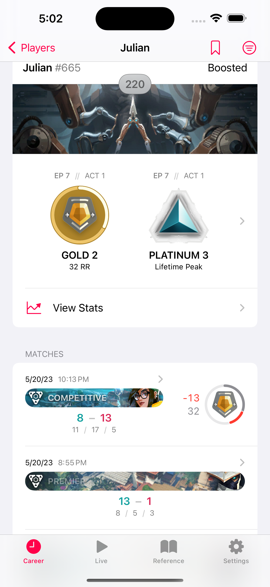
  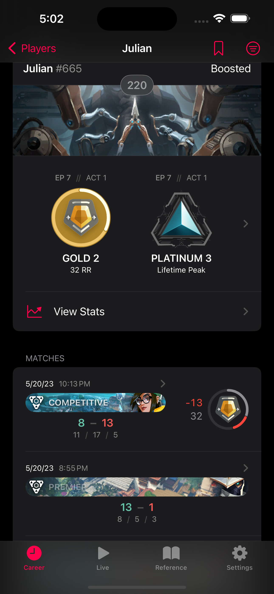

  
  

  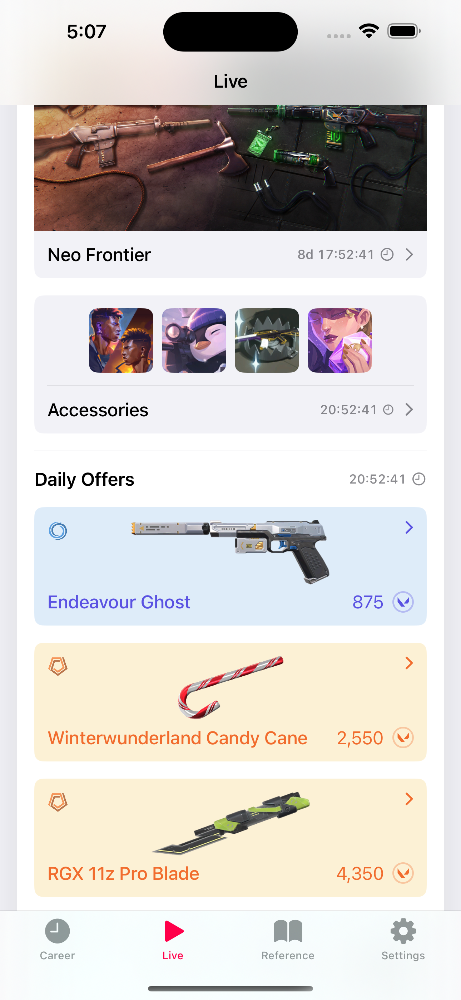
  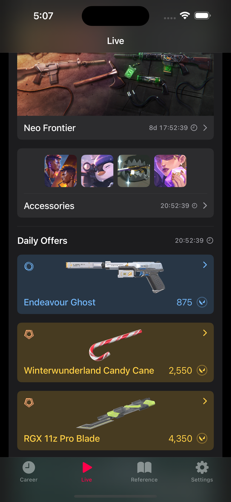

  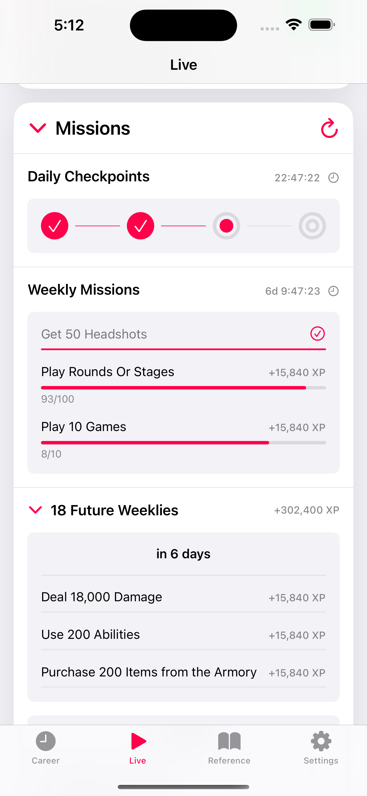
  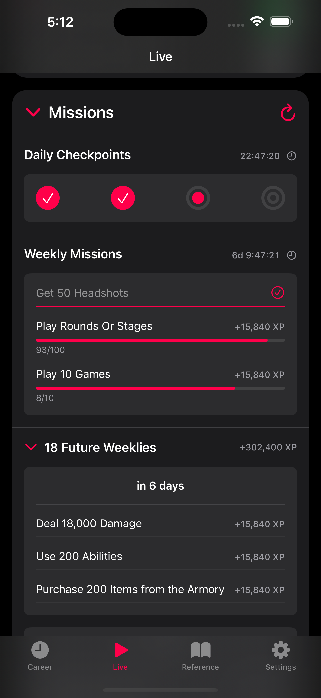

  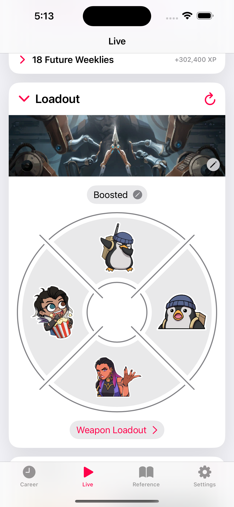
  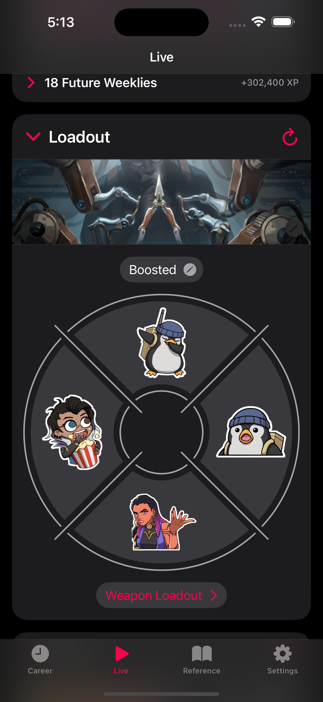

  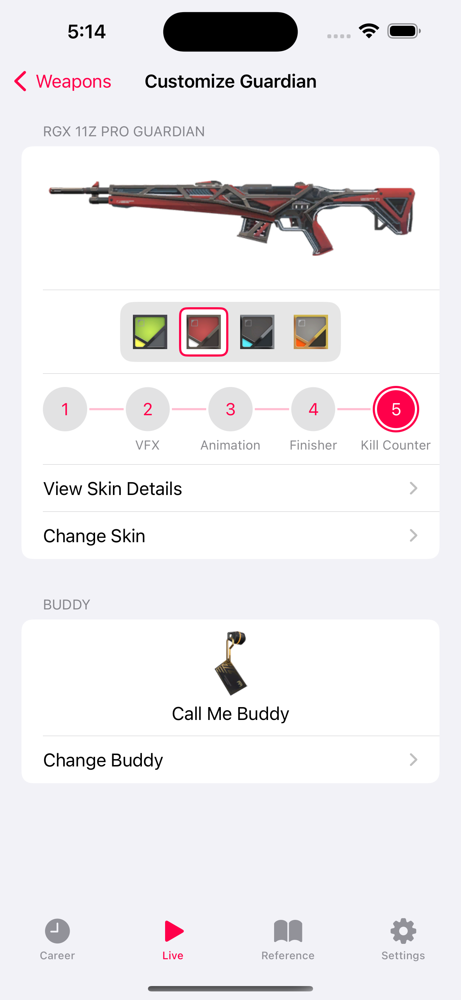
  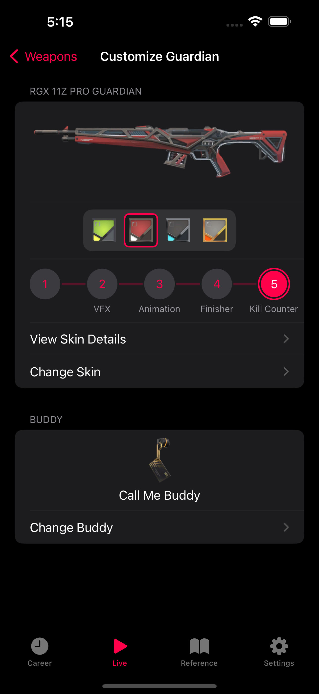

  
  

  
  

  
  

  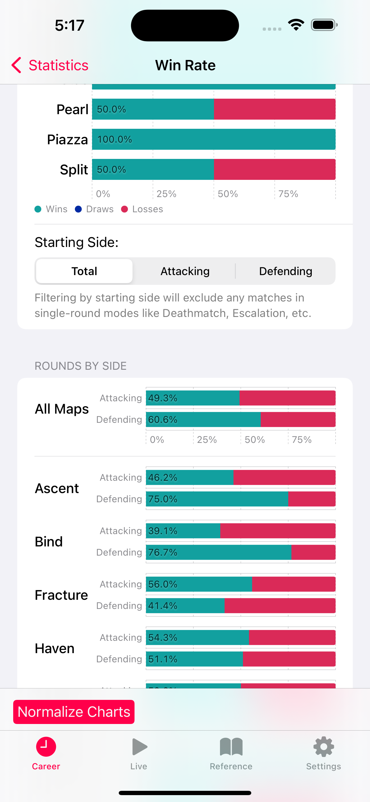
  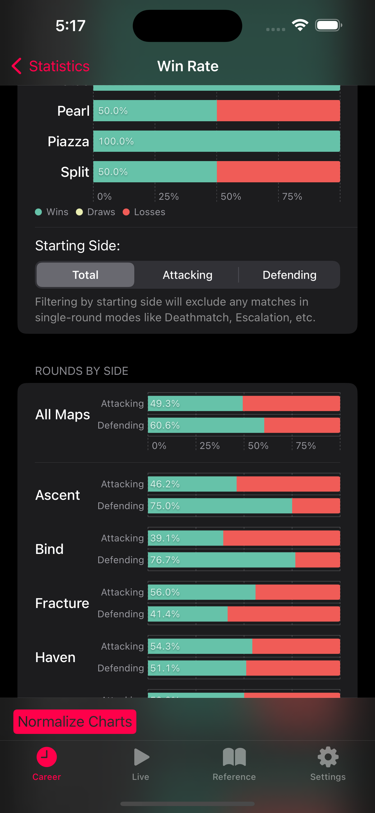

## Credits & Thanks

Recon Bolt and ValorantAPI were originally created by **[Julian Dunskus (juliand665)](https://juliand665.com/)** ([GitHub](https://github.com/juliand665)).

This project would not have been possible (or was significantly eased by) some prior work:

- **[RumbleMike/ValorantStreamOverlay](https://github.com/RumbleMike/ValorantStreamOverlay)** provided the initial inspiration (and even just let me know it was possible).
- **[RumbleMike/ValorantClientAPI](https://github.com/RumbleMike/ValorantClientAPI) and the associated Discord**: This has some nice docs and a great community for working with the API I need.
- **[colinhartigan/valclient.py](https://github.com/colinhartigan/valclient.py)** has filled in where the above docs were incomplete, providing a simple reference of what endpoints exist and how they're accessed.
- **[techchrism/valorant-api-docs](https://github.com/techchrism/valorant-api-docs)** is another documentation effort that I was recently made aware of, which looks both complete and detailed! In fact, it's now my main source, most conveniently accessible [here](https://valapidocs.techchrism.me).
- **[Valorant-API.com](https://valorant-api.com)** has proven to be a truly invaluable API, serving up the game's assets in an easy-to-use format. They were also wonderfully open and responsive to feature/change requests.

## Why not Android?

The vast majority of Recon Bolt is UI Code, which heavily relies on Apple's fantastic new SwiftUI framework. I simply would not have had the motivation to work this much on an app with any other framework I know of, much less for an OS which I don't even use. Sorry!

## Building this repository

The **Build Recon Bolt iOS IPA** workflow (`.github/workflows/build-ipa.yml`) runs on `macos-15` with Xcode 26.3, archives the `Recon Bolt (iOS)` scheme against the revived `ValorantAPI-Revived` package, and uploads an unsigned IPA as a workflow artifact. Install that IPA with Sideloadly or AltStore using your own Apple ID—no paid developer account is required.

The Xcode project resolves `ValorantAPI-Revived` directly, so no submodule checkout is needed for the app build. `Package.swift` is only used for the optional `xtool` single-bundle build.
